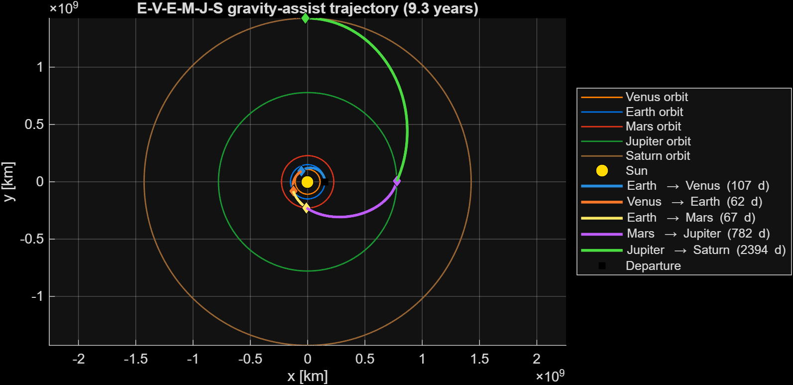
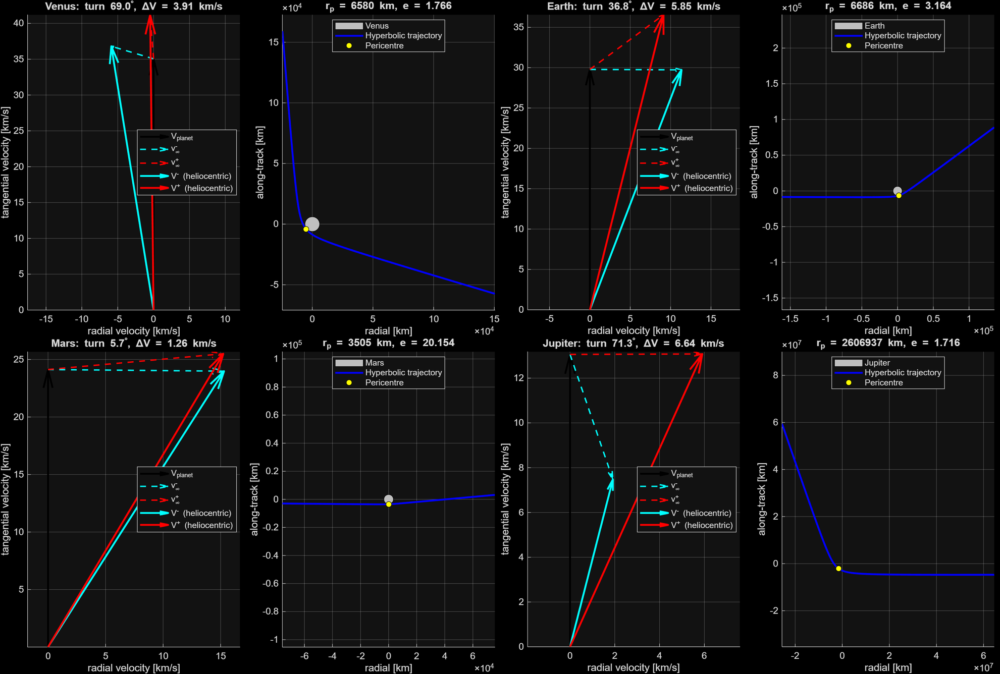

# Multi-Gravity-Assist Transfer to Saturn (Patched Conics)

MATLAB design and optimisation of the interplanetary phase of a mission to Enceladus:
**Earth → Venus → Earth → Mars → Jupiter → Saturn**, with four unpowered gravity assists,
modelled with patched conics and optimised with `fmincon`.



## Highlights

- **Patched-conics chain**: heliocentric Keplerian arcs joined by planet-centred hyperbolic flybys,
  with the turn angle $\delta = 2\arcsin(1/e)$ and $e = 1 + r_p v_\infty^2/\mu$.
- **Optimisation**: 5 design variables (departure $v_\infty$ and the four pericentre altitudes),
  nonlinear constraints on every arc, SQP with scaled variables.
- **Result**: 3.21 km/s departure $v_\infty$, about 17.7 km/s of heliocentric velocity gained from the
  flybys, near-tangential arrival at Saturn ($v_\infty \approx$ 2.51 km/s) after 9.34 years.
- **Outputs**: time of flight of every arc from Kepler's equation, velocity triangles and hyperbolas
  of each flyby, full heliocentric trajectory.

## Model

| Item | Assumption |
|------|------------|
| Planetary orbits | circular and coplanar |
| Phasing | not modelled: each planet is assumed to be at the crossing point |
| Departure | tangential retrograde impulse on the Earth's orbit (Earth at the aphelion of the first arc) |
| Flybys | unpowered, side chosen so that the heliocentric energy increases |
| Arrival | Saturn orbit crossing; orbit insertion handled in a separate phase |

**Design variables**: $x = [\Delta v_{dep},\ h_{Venus},\ h_{Earth},\ h_{Mars},\ h_{Jupiter}]$

**Objective**: $J = |\Delta v_{dep}| + 10^4\,\lVert v_{\infty,Saturn}\rVert$. The arrival
hyperbolic excess speed, which drives the insertion manoeuvre, dominates the cost.

**Constraints**: the first arc reaches Venus (perihelion below the orbit of Venus), every
following arc reaches the next planet (aphelion beyond its orbit).

## Results

Optimum: $x^* = [-3.2130\ \text{km/s},\ 528.2,\ 315.3,\ 115.3,\ 2\,535\,445\ \text{km}]$

| Gravity assist | r_p [km] | v∞ [km/s] | e | Turn [deg] | Heliocentric ΔV [km/s] |
|----------------|----------|-----------|---|------------|------------------------|
| Venus   | 6 580     | 6.149  | 1.766  | 68.99 | 3.913 |
| Earth   | 6 686     | 11.358 | 3.164  | 36.85 | 5.847 |
| Mars    | 3 505     | 15.299 | 20.154 | 5.69  | 1.259 |
| Jupiter | 2 606 937 | 5.906  | 1.716  | 71.29 | 6.638 |

| Arc | a [km] | e | Time of flight [days] |
|-----|--------|---|-----------------------|
| Earth → Venus    | 1.2424·10⁸ | 0.2041 | 106.6 |
| Venus → Earth    | 1.7434·10⁸ | 0.3807 | 62.4 |
| Earth → Mars     | 3.7401·10⁸ | 0.6305 | 66.5 |
| Mars → Jupiter   | 4.7121·10⁸ | 0.6778 | 781.8 |
| Jupiter → Saturn | 9.8195·10⁸ | 0.4529 | 2394.4 |
| **Total**        |            |        | **3411.6 (9.34 years)** |

Arrival at Saturn: $v_r$ = 0.0012 km/s, $v_t$ = 7.134 km/s, hyperbolic excess speed 2.51 km/s.
The optimum places the aphelion of the last arc on the orbit of Saturn (tangential arrival),
which minimises the arrival $v_\infty$ for this sequence.



## Limitations and next steps

This is a first-order design tool, and its assumptions are deliberate simplifications:

- **No phasing**: without ephemerides the planets are not guaranteed to be at the encounter
  points, so the sequence is not tied to a launch date.
- **Extreme sensitivity**: a 5 m/s change in departure speed moves the Saturn aphelion by about
  60 million km, which makes the problem hard for a local optimiser started from a single point.
- **Departure**: the design variable is the hyperbolic excess speed at the Earth; the impulse
  from a 300 km parking orbit would be about 3.66 km/s (instead of 3.21).

A Python version with real ephemerides, Lambert arcs between dated encounters and a
launch-window search is in development.

## Repository structure

```
├── main.m                        # optimisation, summary and plots
└── functions/
    ├── planet_data.m               # planetary constants
    ├── evaluate_mission.m          # propagates the full sequence
    ├── departure_arc.m             # Earth -> Venus arc (tangential retrograde impulse)
    ├── transfer_arc.m              # heliocentric arc after a flyby
    ├── flyby.m                     # gravity assist (patched conics)
    ├── time_of_flight.m            # Kepler's equation (elliptic / hyperbolic)
    ├── mission_cost.m, mission_constraints.m
    ├── print_mission_summary.m
    └── plot_trajectory.m, plot_flyby.m
```

## How to run

Requires MATLAB R2020a or later with the Optimization Toolbox (`fmincon`). Run `main.m`.
The optimum is printed in full precision, followed by the flyby and arc tables.
Set `SAVE_FIGURES = true` to export the plots.

## Context

Developed for the *Interplanetary Trajectories* course at Sapienza University of Rome
(A.Y. 2025/26) as part of a team mission study to Enceladus. This repository contains the
interplanetary module, which I developed individually.

**Girolamo Castronovo** · [LinkedIn](https://www.linkedin.com/in/girolamo-castronovo-286387269/)
